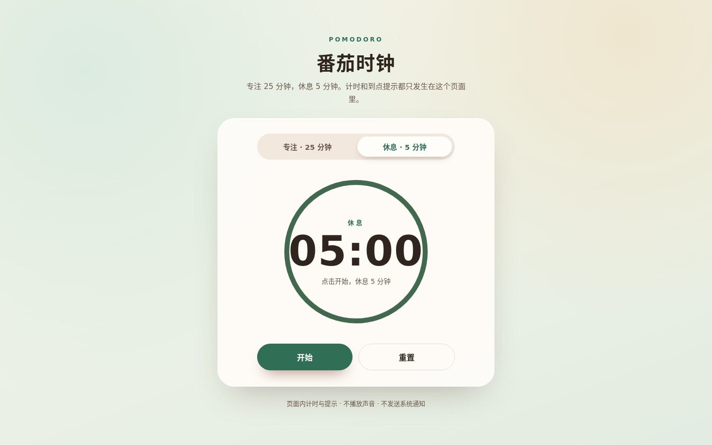
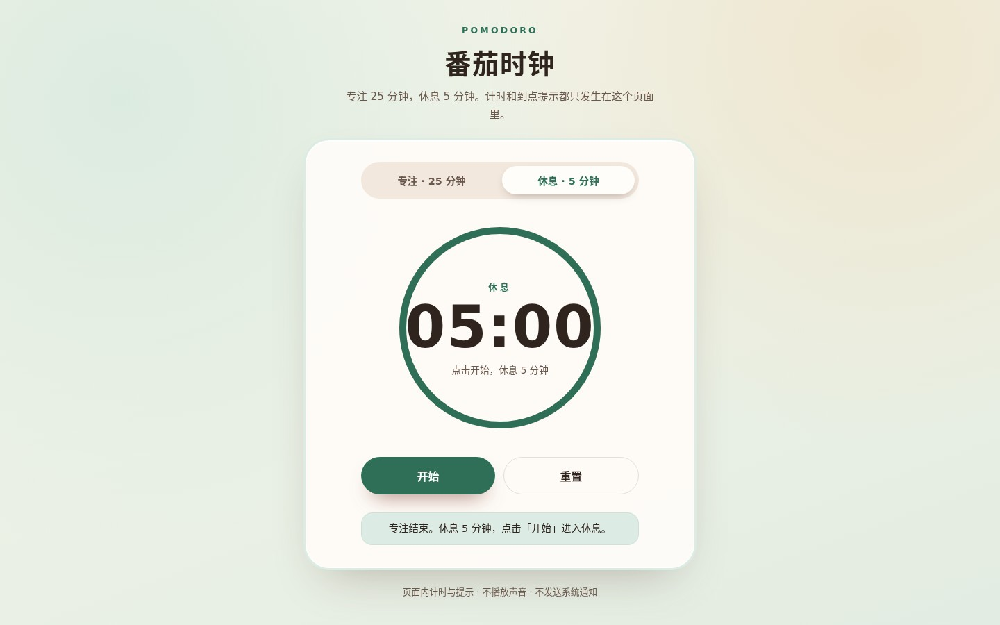

# wanju

## 番茄时钟

一个独立的番茄时钟页面：25 分钟专注、5 分钟休息，只在页面内计时并在阶段结束时给出文字提示。不播放声音，也不使用系统通知。

### 界面预览

以下为实际页面截图（Chrome，浅色主题）：

| 专注阶段 | 计时进行中 |
| :---: | :---: |
|  专注 · 25:00 |  计时中 · 24:59 |
|  休息 · 05:00 |  阶段结束提示 |
|  移动端 · 390×844 | |

- 页面入口：`pomodoro/index.html`，部署到 GitHub Pages 后访问 `/pomodoro/`。
- 本地预览：在仓库根目录运行 `python3 -m http.server 8000`，然后打开 <http://localhost:8000/pomodoro/>。
- 页面文件：`pomodoro/index.html`、`pomodoro/styles.css`、`pomodoro/timer.js`（计时逻辑）、`pomodoro/app.js`（界面绑定）。
- 计时逻辑测试：`npm test`（使用 Node 内置测试运行器，无第三方依赖）。